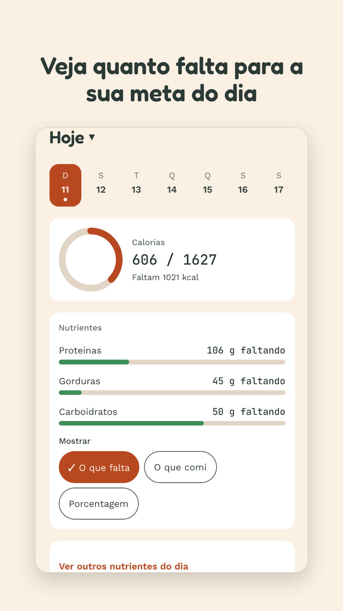
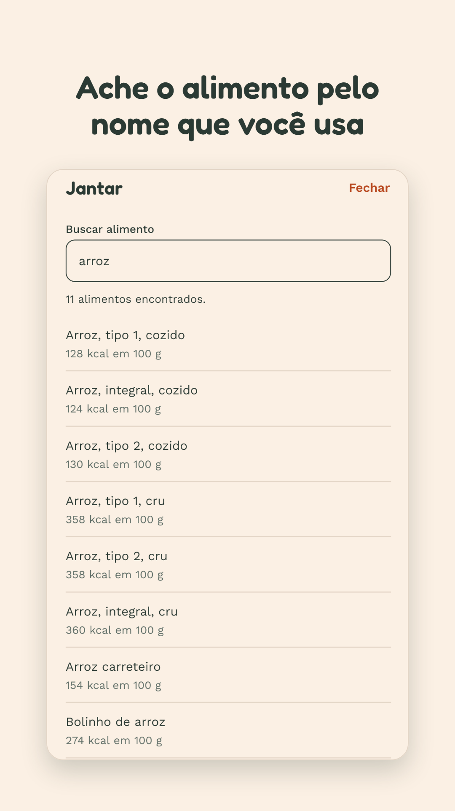
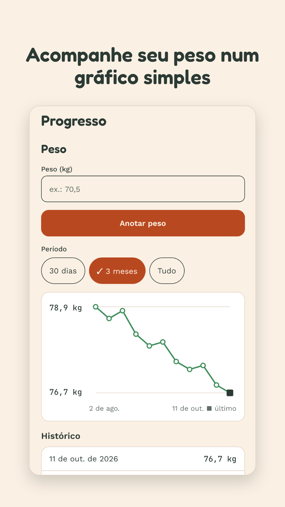
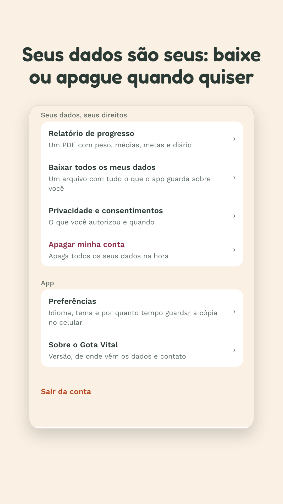
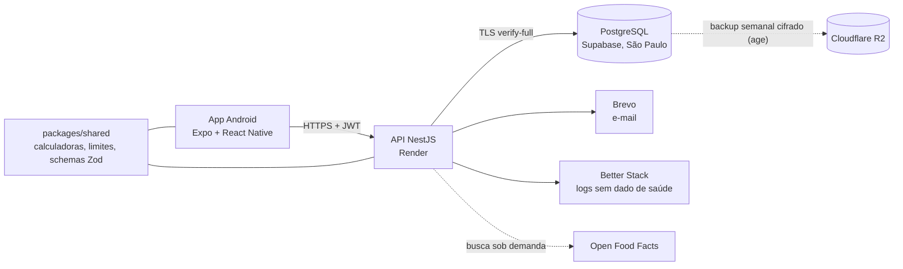

# Gota Vital

[](https://github.com/FireC4io/minhasaude/actions/workflows/ci.yml)
[](https://sonarcloud.io/summary/new_code?id=FireC4io_minhasaude)
[](https://scorecard.dev/viewer/?uri=github.com/FireC4io/minhasaude)

App Android de alimentação e acompanhamento de peso, em português, inglês e espanhol, feito para quem tem pouca
familiaridade com tecnologia, celular simples e internet ruim. Projeto de portfólio com usuários reais: segurança e
LGPD entram desde o início, não depois.

**Situação (outubro de 2026):** Fase 5, preparando o teste fechado na Google Play. A leitura de exames de sangue e
bioimpedância por IA vem na Fase 6. Roteiro completo em [`docs/roadmap.md`](docs/roadmap.md).

<p align="center">
  
  
  
  
</p>

## O que o app faz

- **Diário alimentar** com a Tabela Brasileira de Composição de Alimentos (TACO) e o Open Food Facts. A busca entende
  nomes regionais (aipim, macaxeira, pão de sal) e coloca primeiro o que a pessoa costuma comer.
- **Meta diária** de calorias e macronutrientes estimada a partir do perfil, com ritmo semanal escolhido pela pessoa.
  Toda fórmula grava a própria versão, para o histórico não mudar se ela for corrigida.
- **Peso** com gráfico de evolução e **relatório de progresso em PDF**, gerado no próprio celular.
- **Funciona sem internet** para consultar o que já foi visto (cópia local cifrada com XChaCha20-Poly1305, chave no
  Keystore do Android).
- **Seus dados são seus:** baixar tudo o que o app guarda, revogar consentimentos e apagar a conta na hora.
- **Acessível:** leitor de tela, fonte grande, modo escuro e textos em linguagem simples (referência ABNT NBR 17060).
- Sem anúncios. Informativo, nunca diagnóstico (RDC 657/2022 da Anvisa).

## Arquitetura



- **Monorepo** com pnpm workspaces e Turborepo. O contrato HTTP sai do OpenAPI da API e vira o client tipado do app
  (orval); regras de domínio usadas pelos dois lados ficam no `packages/shared`.
- **API** em camadas (controller → service → repositório do TypeORM), resposta sempre por DTO e migrations versionadas.
  Decisões e alternativas descartadas em [`docs/adr/`](docs/adr).
- **Orçamento zero** de infraestrutura ([ADR-0007](docs/adr/0007-hosting-orcamento-zero-render-supabase-r2.md)), tudo
  configurado por variáveis de ambiente para trocar de provedor sem mudar código.

## Qualidade e segurança

| O quê | Como |
| --- | --- |
| Testes | Unitários (Jest) nos três pacotes, e2e da API contra Postgres real, fluxos do app no Maestro. Cobertura somada no SonarQube Cloud, com Quality Gate obrigatório |
| Estilo | Lint sem nenhum aviso aceito no CI e checagem de lint e tipos antes de cada commit (`.githooks/`) |
| Arquitetura | Regras do `dependency-cruiser` no CI: sem ciclos, `shared` não importa app, API e app não se importam |
| Segredos e dependências | gitleaks no histórico inteiro, `pnpm audit` quebrando em alta/crítica, Dependabot, OpenSSF Scorecard, actions fixadas por hash |
| API | helmet, limite de pedidos por rota, validação com teto em todo texto, guard de autenticação por padrão, senhas com argon2, refresh token rotacionado e revogável |
| Dados de saúde | Consentimento verificado na API, RLS no banco, logs sem dado sensível, exclusão imediata e exportação completa (LGPD) |

Avaliação de segurança completa em [`docs/security/avaliacao-2026-10.md`](docs/security/avaliacao-2026-10.md) e
como reportar uma vulnerabilidade em [`SECURITY.md`](SECURITY.md).

## Rodar localmente

Pré-requisitos: Node.js 24 ou mais novo, pnpm 12.4.2 (`corepack enable`) e Docker.

```bash
pnpm install                         # instala tudo e liga o hook de pré-commit
docker compose up -d postgres        # Postgres local
pnpm --filter @minhasaude/api start:dev    # API em http://localhost:3000 (aplica as migrations e a TACO)
pnpm --filter @minhasaude/mobile start     # app no Expo
```

Variáveis de ambiente da API em [`apps/api/README.md`](apps/api/README.md) e do app em
[`apps/mobile/.env.example`](apps/mobile/.env.example). Antes de enviar uma mudança:

```bash
npx turbo run lint test build --concurrency=1
pnpm --filter @minhasaude/api test:e2e
pnpm deps:check
```

## Estrutura

```
apps/api/          API NestJS (módulos por domínio: auth, users, goals, foods, diary, consents...)
apps/mobile/       app Expo (telas em src/app, regras de tela em src/features)
apps/mobile/store/ imagens da Google Play e o gerador delas
packages/shared/   calculadoras, limites de entrada e schemas compartilhados
packages/config/   eslint, prettier e tsconfig comuns
docs/              ADRs, banco, contrato de API, roadmap, segurança, textos legais e histórico
```

## Produção

- API: https://minhasaude-api.onrender.com (deploy automático a cada push na `main`; o plano gratuito dorme após 15
  minutos sem uso). A documentação Swagger só existe fora de produção.
- Política de privacidade: https://firec4io.github.io/minhasaude/privacidade/
- Como apagar a conta sem o app: https://firec4io.github.io/minhasaude/excluir-conta/

Dados de alimentos: TACO (NEPA/Unicamp) e Open Food Facts (licença ODbL).
