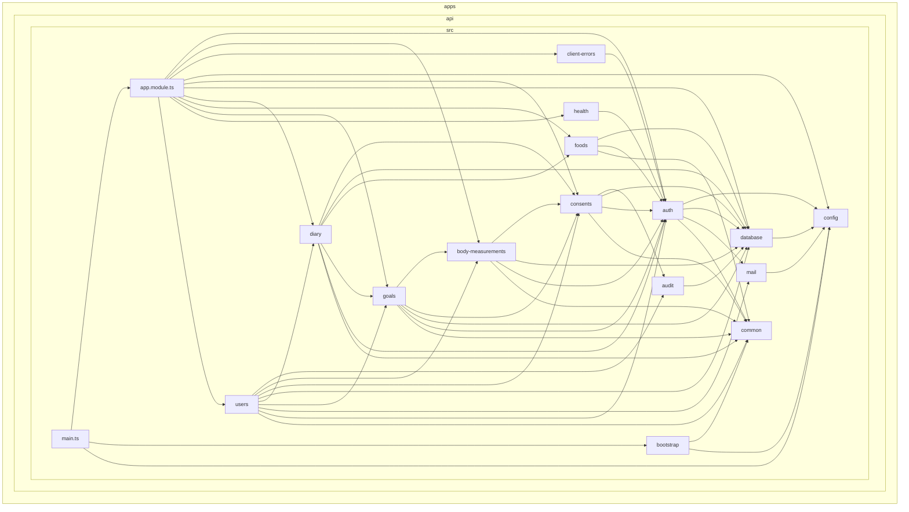
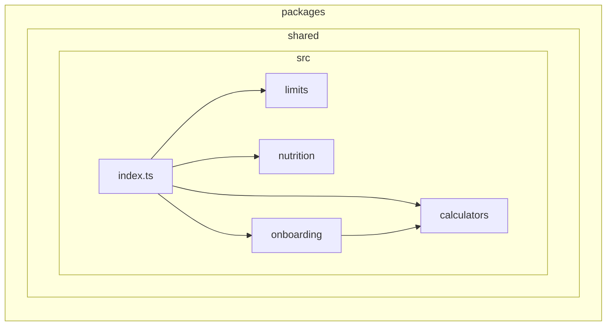

# Mapa de dependências

> Gerado por `pnpm deps:graph` (dependency-cruiser) — não editar à mão.
> Cada caixa é uma pasta; cada seta, "importa de". Testes ficam fora do mapa.
> As regras que este mapa precisa respeitar estão em `.dependency-cruiser.cjs` e rodam no CI (`pnpm deps:check`).

## API (NestJS) — módulos de `apps/api/src`

## App (Expo) — pastas de `apps/mobile/src`

```mermaid
flowchart LR

subgraph apps["apps"]
  subgraph apps_mobile["mobile"]
    subgraph apps_mobile_src["src"]
      apps_mobile_src_api["api"]
      subgraph apps_mobile_src_app["app"]
        apps_mobile_src_app__app_["(app)"]
        apps_mobile_src_app__auth_["(auth)"]
        apps_mobile_src_app__onboarding_["(onboarding)"]
        apps_mobile_src_app__layout_tsx["_layout.tsx"]
        apps_mobile_src_app_account["account"]
        apps_mobile_src_app_dev_catalog_tsx["dev-catalog.tsx"]
        apps_mobile_src_app_diary_entry_tsx["diary-entry.tsx"]
        apps_mobile_src_app_exam["exam"]
        apps_mobile_src_app_policy_update_tsx["policy-update.tsx"]
        apps_mobile_src_app_quick_add_tsx["quick-add.tsx"]
        apps_mobile_src_app_voice_entry_tsx["voice-entry.tsx"]
        apps_mobile_src_app_water_tsx["water.tsx"]
        apps_mobile_src_app_weight_entry_tsx["weight-entry.tsx"]
      end
      subgraph apps_mobile_src_components["components"]
        apps_mobile_src_components_app_tabs_tsx["app-tabs.tsx"]
        apps_mobile_src_components_app_tabs_web_tsx["app-tabs.web.tsx"]
        apps_mobile_src_components_ui["ui"]
      end
      apps_mobile_src_config["config"]
      apps_mobile_src_constants["constants"]
      subgraph apps_mobile_src_features["features"]
        apps_mobile_src_features_accessibility["accessibility"]
        apps_mobile_src_features_account["account"]
        apps_mobile_src_features_auth["auth"]
        apps_mobile_src_features_dev_catalog["dev-catalog"]
        apps_mobile_src_features_diary["diary"]
        apps_mobile_src_features_errors["errors"]
        apps_mobile_src_features_exams["exams"]
        apps_mobile_src_features_forms["forms"]
        apps_mobile_src_features_navigation["navigation"]
        apps_mobile_src_features_network["network"]
        apps_mobile_src_features_nutrition["nutrition"]
        apps_mobile_src_features_offline_queue["offline-queue"]
        apps_mobile_src_features_onboarding["onboarding"]
        apps_mobile_src_features_preferences["preferences"]
        apps_mobile_src_features_preview["preview"]
        apps_mobile_src_features_profile["profile"]
        apps_mobile_src_features_progress["progress"]
        apps_mobile_src_features_reminders["reminders"]
        apps_mobile_src_features_report["report"]
        apps_mobile_src_features_today["today"]
        apps_mobile_src_features_voice["voice"]
        apps_mobile_src_features_water["water"]
        apps_mobile_src_features_weight["weight"]
      end
      apps_mobile_src_global_css["global.css"]
      apps_mobile_src_i18n["i18n"]
    end
  end
end
apps_mobile_src_api-->apps_mobile_src_features_preferences
apps_mobile_src_app__app_-->apps_mobile_src_components_app_tabs_tsx
apps_mobile_src_app__app_-->apps_mobile_src_features_offline_queue
apps_mobile_src_app__app_-->apps_mobile_src_features_reminders
apps_mobile_src_app__app_-->apps_mobile_src_components_ui
apps_mobile_src_app__app_-->apps_mobile_src_config
apps_mobile_src_app__app_-->apps_mobile_src_features_auth
apps_mobile_src_app__app_-->apps_mobile_src_features_exams
apps_mobile_src_app__app_-->apps_mobile_src_api
apps_mobile_src_app__app_-->apps_mobile_src_features_diary
apps_mobile_src_app__app_-->apps_mobile_src_features_network
apps_mobile_src_app__app_-->apps_mobile_src_features_nutrition
apps_mobile_src_app__app_-->apps_mobile_src_features_today
apps_mobile_src_app__app_-->apps_mobile_src_features_water
apps_mobile_src_app__app_-->apps_mobile_src_features_weight
apps_mobile_src_app__app_-->apps_mobile_src_features_onboarding
apps_mobile_src_app__app_-->apps_mobile_src_features_progress
apps_mobile_src_app__auth_-->apps_mobile_src_api
apps_mobile_src_app__auth_-->apps_mobile_src_components_ui
apps_mobile_src_app__auth_-->apps_mobile_src_features_auth
apps_mobile_src_app__auth_-->apps_mobile_src_i18n
apps_mobile_src_app__auth_-->apps_mobile_src_config
apps_mobile_src_app__onboarding_-->apps_mobile_src_api
apps_mobile_src_app__onboarding_-->apps_mobile_src_components_ui
apps_mobile_src_app__onboarding_-->apps_mobile_src_features_auth
apps_mobile_src_app__onboarding_-->apps_mobile_src_features_onboarding
apps_mobile_src_app__onboarding_-->apps_mobile_src_features_profile
apps_mobile_src_app__onboarding_-->apps_mobile_src_features_accessibility
apps_mobile_src_app__onboarding_-->apps_mobile_src_features_forms
apps_mobile_src_app__layout_tsx-->apps_mobile_src_api
apps_mobile_src_app__layout_tsx-->apps_mobile_src_constants
apps_mobile_src_app__layout_tsx-->apps_mobile_src_features_auth
apps_mobile_src_app__layout_tsx-->apps_mobile_src_features_errors
apps_mobile_src_app__layout_tsx-->apps_mobile_src_features_network
apps_mobile_src_app__layout_tsx-->apps_mobile_src_features_onboarding
apps_mobile_src_app__layout_tsx-->apps_mobile_src_features_preferences
apps_mobile_src_app__layout_tsx-->apps_mobile_src_global_css
apps_mobile_src_app__layout_tsx-->apps_mobile_src_i18n
apps_mobile_src_app_account-->apps_mobile_src_features_navigation
apps_mobile_src_app_account-->apps_mobile_src_components_ui
apps_mobile_src_app_account-->apps_mobile_src_features_account
apps_mobile_src_app_account-->apps_mobile_src_api
apps_mobile_src_app_account-->apps_mobile_src_features_accessibility
apps_mobile_src_app_account-->apps_mobile_src_features_auth
apps_mobile_src_app_account-->apps_mobile_src_features_network
apps_mobile_src_app_account-->apps_mobile_src_features_profile
apps_mobile_src_app_account-->apps_mobile_src_features_onboarding
apps_mobile_src_app_account-->apps_mobile_src_features_preferences
apps_mobile_src_app_account-->apps_mobile_src_i18n
apps_mobile_src_app_account-->apps_mobile_src_features_diary
apps_mobile_src_app_account-->apps_mobile_src_features_reminders
apps_mobile_src_app_account-->apps_mobile_src_features_report
apps_mobile_src_app_dev_catalog_tsx-->apps_mobile_src_features_dev_catalog
apps_mobile_src_app_diary_entry_tsx-->apps_mobile_src_api
apps_mobile_src_app_diary_entry_tsx-->apps_mobile_src_components_ui
apps_mobile_src_app_diary_entry_tsx-->apps_mobile_src_features_accessibility
apps_mobile_src_app_diary_entry_tsx-->apps_mobile_src_features_auth
apps_mobile_src_app_diary_entry_tsx-->apps_mobile_src_features_diary
apps_mobile_src_app_diary_entry_tsx-->apps_mobile_src_features_forms
apps_mobile_src_app_diary_entry_tsx-->apps_mobile_src_features_offline_queue
apps_mobile_src_app_exam-->apps_mobile_src_components_ui
apps_mobile_src_app_exam-->apps_mobile_src_features_accessibility
apps_mobile_src_app_exam-->apps_mobile_src_features_auth
apps_mobile_src_app_exam-->apps_mobile_src_features_exams
apps_mobile_src_app_exam-->apps_mobile_src_features_navigation
apps_mobile_src_app_exam-->apps_mobile_src_features_onboarding
apps_mobile_src_app_exam-->apps_mobile_src_api
apps_mobile_src_app_exam-->apps_mobile_src_i18n
apps_mobile_src_app_exam-->apps_mobile_src_features_forms
apps_mobile_src_app_policy_update_tsx-->apps_mobile_src_api
apps_mobile_src_app_policy_update_tsx-->apps_mobile_src_components_ui
apps_mobile_src_app_policy_update_tsx-->apps_mobile_src_features_auth
apps_mobile_src_app_policy_update_tsx-->apps_mobile_src_features_onboarding
apps_mobile_src_app_quick_add_tsx-->apps_mobile_src_api
apps_mobile_src_app_quick_add_tsx-->apps_mobile_src_components_ui
apps_mobile_src_app_quick_add_tsx-->apps_mobile_src_config
apps_mobile_src_app_quick_add_tsx-->apps_mobile_src_features_diary
apps_mobile_src_app_quick_add_tsx-->apps_mobile_src_features_today
apps_mobile_src_app_voice_entry_tsx-->apps_mobile_src_api
apps_mobile_src_app_voice_entry_tsx-->apps_mobile_src_components_ui
apps_mobile_src_app_voice_entry_tsx-->apps_mobile_src_features_auth
apps_mobile_src_app_voice_entry_tsx-->apps_mobile_src_features_diary
apps_mobile_src_app_voice_entry_tsx-->apps_mobile_src_features_forms
apps_mobile_src_app_voice_entry_tsx-->apps_mobile_src_features_onboarding
apps_mobile_src_app_voice_entry_tsx-->apps_mobile_src_features_today
apps_mobile_src_app_voice_entry_tsx-->apps_mobile_src_features_voice
apps_mobile_src_app_water_tsx-->apps_mobile_src_components_ui
apps_mobile_src_app_water_tsx-->apps_mobile_src_features_accessibility
apps_mobile_src_app_water_tsx-->apps_mobile_src_features_auth
apps_mobile_src_app_water_tsx-->apps_mobile_src_features_diary
apps_mobile_src_app_water_tsx-->apps_mobile_src_features_preview
apps_mobile_src_app_water_tsx-->apps_mobile_src_features_water
apps_mobile_src_app_weight_entry_tsx-->apps_mobile_src_components_ui
apps_mobile_src_app_weight_entry_tsx-->apps_mobile_src_features_weight
apps_mobile_src_components_app_tabs_tsx-->apps_mobile_src_constants
apps_mobile_src_components_app_tabs_web_tsx-->apps_mobile_src_components_ui
apps_mobile_src_components_app_tabs_web_tsx-->apps_mobile_src_constants
apps_mobile_src_components_ui-->apps_mobile_src_constants
apps_mobile_src_components_ui-->apps_mobile_src_features_accessibility
apps_mobile_src_features_accessibility-->apps_mobile_src_i18n
apps_mobile_src_features_account-->apps_mobile_src_features_diary
apps_mobile_src_features_account-->apps_mobile_src_api
apps_mobile_src_features_account-->apps_mobile_src_i18n
apps_mobile_src_features_auth-->apps_mobile_src_components_ui
apps_mobile_src_features_auth-->apps_mobile_src_constants
apps_mobile_src_features_auth-->apps_mobile_src_api
apps_mobile_src_features_auth-->apps_mobile_src_features_offline_queue
apps_mobile_src_features_auth-->apps_mobile_src_features_reminders
apps_mobile_src_features_auth-->apps_mobile_src_features_accessibility
apps_mobile_src_features_dev_catalog-->apps_mobile_src_components_ui
apps_mobile_src_features_dev_catalog-->apps_mobile_src_constants
apps_mobile_src_features_dev_catalog-->apps_mobile_src_features_auth
apps_mobile_src_features_dev_catalog-->apps_mobile_src_features_onboarding
apps_mobile_src_features_diary-->apps_mobile_src_api
apps_mobile_src_features_diary-->apps_mobile_src_i18n
apps_mobile_src_features_diary-->apps_mobile_src_components_ui
apps_mobile_src_features_diary-->apps_mobile_src_features_accessibility
apps_mobile_src_features_diary-->apps_mobile_src_constants
apps_mobile_src_features_diary-->apps_mobile_src_features_offline_queue
apps_mobile_src_features_diary-->apps_mobile_src_features_auth
apps_mobile_src_features_diary-->apps_mobile_src_features_forms
apps_mobile_src_features_diary-->apps_mobile_src_features_nutrition
apps_mobile_src_features_diary-->apps_mobile_src_features_onboarding
apps_mobile_src_features_errors-->apps_mobile_src_api
apps_mobile_src_features_errors-->apps_mobile_src_features_account
apps_mobile_src_features_errors-->apps_mobile_src_components_ui
apps_mobile_src_features_errors-->apps_mobile_src_features_auth
apps_mobile_src_features_exams-->apps_mobile_src_i18n
apps_mobile_src_features_exams-->apps_mobile_src_features_preview
apps_mobile_src_features_exams-->apps_mobile_src_components_ui
apps_mobile_src_features_exams-->apps_mobile_src_constants
apps_mobile_src_features_exams-->apps_mobile_src_features_weight
apps_mobile_src_features_navigation-->apps_mobile_src_constants
apps_mobile_src_features_navigation-->apps_mobile_src_features_accessibility
apps_mobile_src_features_network-->apps_mobile_src_components_ui
apps_mobile_src_features_nutrition-->apps_mobile_src_components_ui
apps_mobile_src_features_nutrition-->apps_mobile_src_i18n
apps_mobile_src_features_offline_queue-->apps_mobile_src_api
apps_mobile_src_features_offline_queue-->apps_mobile_src_features_diary
apps_mobile_src_features_offline_queue-->apps_mobile_src_features_weight
apps_mobile_src_features_offline_queue-->apps_mobile_src_components_ui
apps_mobile_src_features_onboarding-->apps_mobile_src_components_ui
apps_mobile_src_features_onboarding-->apps_mobile_src_constants
apps_mobile_src_features_onboarding-->apps_mobile_src_i18n
apps_mobile_src_features_onboarding-->apps_mobile_src_api
apps_mobile_src_features_onboarding-->apps_mobile_src_features_accessibility
apps_mobile_src_features_onboarding-->apps_mobile_src_features_auth
apps_mobile_src_features_preferences-->apps_mobile_src_i18n
apps_mobile_src_features_profile-->apps_mobile_src_api
apps_mobile_src_features_profile-->apps_mobile_src_components_ui
apps_mobile_src_features_profile-->apps_mobile_src_features_accessibility
apps_mobile_src_features_profile-->apps_mobile_src_features_auth
apps_mobile_src_features_profile-->apps_mobile_src_features_forms
apps_mobile_src_features_profile-->apps_mobile_src_features_onboarding
apps_mobile_src_features_profile-->apps_mobile_src_i18n
apps_mobile_src_features_progress-->apps_mobile_src_i18n
apps_mobile_src_features_progress-->apps_mobile_src_api
apps_mobile_src_features_progress-->apps_mobile_src_components_ui
apps_mobile_src_features_progress-->apps_mobile_src_features_accessibility
apps_mobile_src_features_progress-->apps_mobile_src_features_diary
apps_mobile_src_features_progress-->apps_mobile_src_features_today
apps_mobile_src_features_reminders-->apps_mobile_src_features_diary
apps_mobile_src_features_reminders-->apps_mobile_src_features_offline_queue
apps_mobile_src_features_reminders-->apps_mobile_src_components_ui
apps_mobile_src_features_reminders-->apps_mobile_src_constants
apps_mobile_src_features_report-->apps_mobile_src_api
apps_mobile_src_features_report-->apps_mobile_src_features_diary
apps_mobile_src_features_report-->apps_mobile_src_features_accessibility
apps_mobile_src_features_report-->apps_mobile_src_features_weight
apps_mobile_src_features_report-->apps_mobile_src_i18n
apps_mobile_src_features_today-->apps_mobile_src_components_ui
apps_mobile_src_features_today-->apps_mobile_src_constants
apps_mobile_src_features_today-->apps_mobile_src_features_accessibility
apps_mobile_src_features_today-->apps_mobile_src_features_diary
apps_mobile_src_features_today-->apps_mobile_src_i18n
apps_mobile_src_features_today-->apps_mobile_src_api
apps_mobile_src_features_today-->apps_mobile_src_features_onboarding
apps_mobile_src_features_today-->apps_mobile_src_features_preview
apps_mobile_src_features_voice-->apps_mobile_src_api
apps_mobile_src_features_voice-->apps_mobile_src_components_ui
apps_mobile_src_features_voice-->apps_mobile_src_features_auth
apps_mobile_src_features_voice-->apps_mobile_src_features_diary
apps_mobile_src_features_voice-->apps_mobile_src_features_forms
apps_mobile_src_features_water-->apps_mobile_src_components_ui
apps_mobile_src_features_water-->apps_mobile_src_features_accessibility
apps_mobile_src_features_water-->apps_mobile_src_features_preview
apps_mobile_src_features_water-->apps_mobile_src_i18n
apps_mobile_src_features_weight-->apps_mobile_src_i18n
apps_mobile_src_features_weight-->apps_mobile_src_api
apps_mobile_src_features_weight-->apps_mobile_src_components_ui
apps_mobile_src_features_weight-->apps_mobile_src_features_offline_queue
apps_mobile_src_features_weight-->apps_mobile_src_constants
apps_mobile_src_features_weight-->apps_mobile_src_features_accessibility
apps_mobile_src_features_weight-->apps_mobile_src_features_auth
apps_mobile_src_features_weight-->apps_mobile_src_features_forms
```

## Shared — `packages/shared/src`

